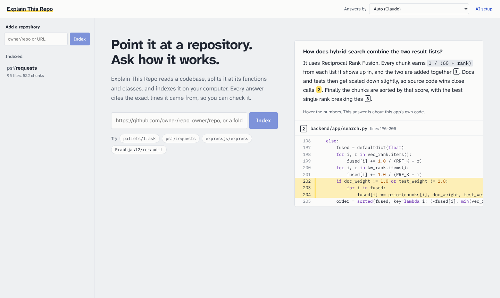
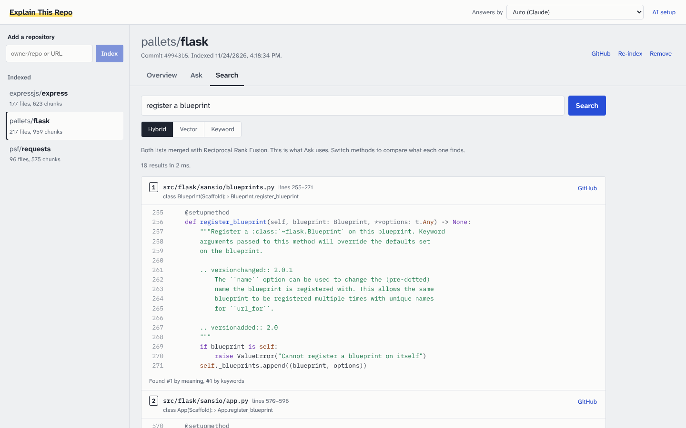
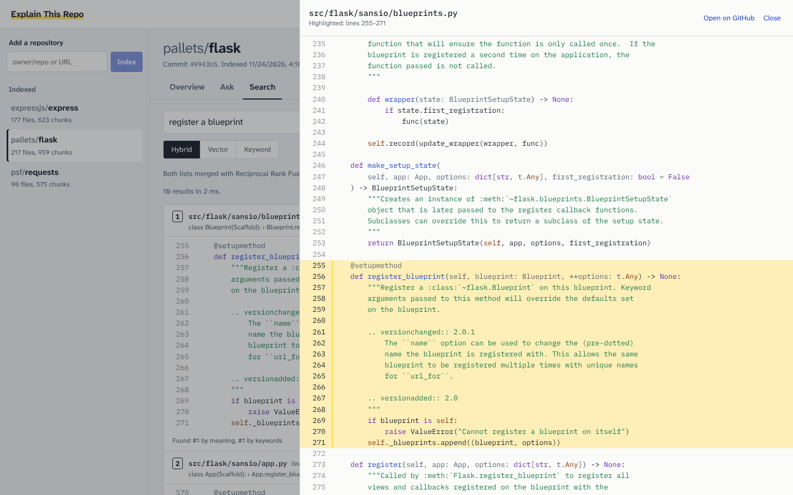
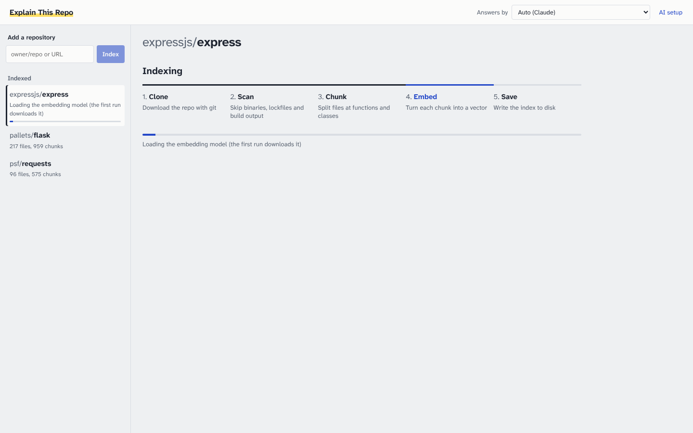

# Explain This Repo

Point it at a GitHub repository (or a folder on your computer) and ask how the code works. Answers come from a
retrieval-augmented generation (RAG) pipeline, and every claim cites the exact file and lines it came from.



- **Overview:** a written orientation guide: what the project is, how it's organized, the main flow, which files to read first.
- **Ask:** questions in plain English, answered from the code. Hover a citation like `[2]` to highlight its lines.
- **Search:** the retrieval step on its own, with keyword, vector and hybrid search side by side.
- Runs locally. Indexing and search happen on your machine. Answers can use your existing **Claude or ChatGPT
  subscription** (no API key), an API key, a free local model through Ollama, or no model at all.

## Quick start

Needs Python 3.10+ and git. Node.js is only needed to rebuild the interface.

```bash
git clone https://github.com/Prabhjas12/explain-this-repo
cd explain-this-repo
./run.sh
```

The first run creates a virtual environment, installs the Python packages, builds the interface if needed, and
opens http://127.0.0.1:8000. The first repo you index also downloads the embedding model (about 70 MB).

### Connect a model (for written answers)

Pick one. The **Answers by** menu shows which are ready, and **Auto** uses the first one that is.

| Option | Setup |
|---|---|
| Claude, with your subscription | `curl -fsSL https://claude.ai/install.sh \| bash` then `claude auth login` |
| ChatGPT, with your subscription | `npm install -g @openai/codex` then `codex login` |
| Claude API / OpenAI API | put `ANTHROPIC_API_KEY=...` or `OPENAI_API_KEY=...` in `.env` |
| Ollama (free, local) | `ollama serve` and `ollama pull qwen2.5-coder:7b` |
| None | search and the structural overview still work |

The Claude Code and Codex CLIs run with their own tools (shell, file editing, web) switched off, in an empty temporary
folder, and with API keys removed from their environment so the subscription is what gets used. They only see the
question and the retrieved snippets.

## How it works

```
              INDEXING (once per repo, seconds to a minute)                     ASKING (every question)

 GitHub URL ─► 1. Clone ─► 2. Scan ─► 3. Chunk ─► 4. Embed ─► 5. Save      question
               git clone   skip       split at    bge-small   vectors.npy      │
               --depth 1   binaries,  functions   384-dim     chunks.jsonl     ▼
                           lockfiles, & classes   vectors     repo_map.json   ┌──────────────┐  ┌──────────────┐
                           build                                              │ vector search│  │ keyword BM25 │
                           output                                             └──────┬───────┘  └──────┬───────┘
                                                                                     └──► fuse (RRF) ◄─┘
                                                                                            │  top 8 chunks
                                                                                            ▼
                                                                           prompt: numbered snippets + question
                                                                                            │
                                                                                            ▼
                                                                         LLM answer that cites [1] [2] ...
```

**1. Ingest** (`backend/app/ingest.py`). Shallow-clones the repo, lists files with `git ls-files` (so `.gitignore`
is respected), and skips binaries, lockfiles, minified bundles, changelogs and anything too large. Jupyter notebooks keep
their code and markdown cells and drop their outputs.

**2. Chunk** (`chunking.py`). Retrieval returns chunks, so chunk boundaries decide answer quality. Python files are
parsed with the standard-library `ast` module and split at top-level functions and classes; big classes are split into
methods labeled `Class.method`, with the class line kept as context. Other languages use an indentation-based splitter:
a block's statements start at its lowest indentation, so it cuts there, and steps one level in (keeping the outer
declaration as context) when a block is still too big. Leading comments and decorators stay attached to the code they
describe. Small neighbors are packed together, and anything still over ~3,000 characters becomes overlapping windows.
A test checks that every line of every file lands in at least one chunk.

**3. Embed** (`embeddings.py`). Each chunk, prefixed with its file path and symbol name, becomes a 384-number vector
from [BAAI/bge-small-en-v1.5](https://huggingface.co/BAAI/bge-small-en-v1.5), run locally through ONNX Runtime via
`fastembed`, with no PyTorch. Vectors are normalized so cosine similarity is a dot product. Re-indexing a repo reuses
vectors for chunks whose text didn't change (keyed by a content hash), so updates only embed what changed.

**4. Store** (`store.py`). A NumPy matrix plus a JSON-lines file per repo. Search is exact brute force: for 20,000
chunks that's about 7.7 million multiply-adds, around a millisecond. An approximate index (FAISS, HNSW) would only pay
off at millions of chunks.

**5. Retrieve** (`search.py`). Two retrievers with different strengths:
- *Vector search* finds code with the same meaning: "where do failed requests get retried" matches `max_retries` logic.
- *BM25 keyword search* finds exact names, which embeddings are bad at. The tokenizer splits identifiers
  (`getUserName` → get, user, name) and lightly stems words so English questions can match code.
- *Hybrid* merges the two ranked lists with **Reciprocal Rank Fusion**: each chunk scores `1 / (60 + rank)` per list.
  Because only ranks are used, cosine scores and BM25 scores never have to be put on the same scale.
- A small **prior** then scales prose docs (×0.8) and tests (×0.7), and at most 3 chunks per file are kept.

**6. Generate** (`prompts.py`, `llm.py`, `rag.py`). The model gets a compact file tree, the last few chat turns, the
numbered snippets (`[3] src/app.py (lines 40-72) · App.run`) and the question, with instructions to answer only from
the snippets and cite them. The API streams the response in two parts: the sources as soon as retrieval finishes
(a few ms), then the answer, so the interface shows the code while the model is still writing. Short follow-ups
("where is it called?") borrow the previous question so retrieval has a subject.

**Overview.** "What does this repo do?" is a bad retrieval query because the answer is spread across the whole repo.
So the overview uses a structural summary instead of search: the README, file tree, language breakdown, manifests
(`package.json`, `pyproject.toml`, ...), likely entry points, and the functions defined in the 25 most important files.

## Measuring retrieval

`eval/` has 48 hand-written questions about two real repos (Flask and Requests), each labeled with the file(s) that
hold the answer, checked against the code. The script runs every question through each retrieval method and records the
rank of the first correct file.

```bash
.venv/bin/python eval/run_eval.py
```

| Method (48 questions) | Right file ranked #1 | In top 3 | In top 5 | MRR |
|---|---|---|---|---|
| Keyword (BM25) | 38% | 67% | 77% | 0.54 |
| Vector | 29% | 56% | 75% | 0.46 |
| Hybrid (plain RRF) | 33% | 69% | 79% | 0.54 |
| **Hybrid + source-code prior (default)** | **75%** | **88%** | **92%** | **0.82** |

These numbers were measured with the small offline `wordllama` embedding model, not the default bge-small, so
**rerun the script on your machine** to get numbers for the default setup. The eval also explains the prior: in 28 of
the 32 cases where plain hybrid ranked the wrong file first, the winner was a documentation page. Docs are written in
English, like questions, so they match unusually well. Weighting docs at 0.8 and tests at 0.7 fixed most of these
without breaking the questions that docs should answer ("How do I install Flask?"); heavier weights did break them. The
weight was picked on these same 48 questions, so treat it as tuned, not held-out.

## Screenshots

| Search: compare retrieval methods | Any citation opens the full file |
|---|---|
|  |  |



## Configuration

Copy `.env.example` to `.env`. Everything is optional.

| Variable | Default | |
|---|---|---|
| `ETR_LLM` | `auto` | `claude`, `codex`, `anthropic`, `openai`, `ollama` or `none` |
| `ETR_LLM_MODEL` | provider default | model name for the provider set in `ETR_LLM` |
| `ETR_EMBEDDINGS` | `fastembed` | `openai` (needs a key) or `wordllama` (16 MB, lower quality, `pip install wordllama`) |
| `ETR_EMBEDDING_MODEL` | `BAAI/bge-small-en-v1.5` | any fastembed text model |
| `ETR_TOP_K` | `8` | snippets given to the model per question |
| `ETR_DOC_WEIGHT` / `ETR_TEST_WEIGHT` | `0.8` / `0.7` | set to `1.0` to rank docs and tests like code |
| `ETR_MAX_FILES` | `5000` | files read per repo |
| `ETR_PORT` | `8000` | |

Private repos: clone them yourself and paste the folder path.

## API

```
GET    /api/health                       providers available, embedding model
GET    /api/repos                        indexed repos and indexing in progress
POST   /api/repos        {"source"}      index a GitHub URL, owner/repo, or folder path
GET    /api/repos/{id}/job               indexing progress
POST   /api/repos/{id}/ask?stream=true   {"question","history","provider","mode"} -> sources, then answer (NDJSON)
POST   /api/repos/{id}/search            {"query","mode","k"} -> ranked chunks
GET    /api/repos/{id}/overview          generated overview (cached per provider)
GET    /api/repos/{id}/file?path=...     one indexed file (others are refused)
DELETE /api/repos/{id}                   remove the index
```

Interactive docs at http://127.0.0.1:8000/docs while it's running.

## Project structure

```
run.sh                  set up and start (creates .venv on first run)
backend/app/
  main.py               FastAPI routes; also serves the built frontend
  ingest.py             clone, list and filter files
  chunking.py           AST and indentation-aware chunking
  embeddings.py         fastembed / OpenAI / wordllama / hashing (tests)
  search.py             BM25, vector search, Reciprocal Rank Fusion, prior
  store.py              on-disk index format and in-memory cache
  repo_map.py           file tree, languages, entry points, file outlines
  indexer.py            the pipeline + background jobs with progress
  prompts.py            prompts for answers and overviews
  llm.py                Claude Code, Codex, Anthropic, OpenAI, Ollama
  rag.py                retrieve -> prompt -> generate, streaming
backend/tests/          42 tests: chunking, search, API end to end
frontend/src/           React + TypeScript (Vite)
eval/                   question sets and the retrieval benchmark
```

## Development

```bash
.venv/bin/pip install -r backend/requirements-dev.txt
cd backend && ../.venv/bin/python -m pytest -q        # no downloads or model needed

cd frontend && npm install && npm run dev             # UI on :5173, proxies /api to :8000
```

## Limitations

- Chunking is exact for Python and heuristic for other languages (indentation, not a real parser). Tree-sitter would
  make it exact everywhere.
- Answers arrive in one piece rather than token by token.
- One user on one machine: no auth, and the server only listens on 127.0.0.1.
- The eval set is small (48 questions, 2 repos) and hand-labeled.

## License

MIT
